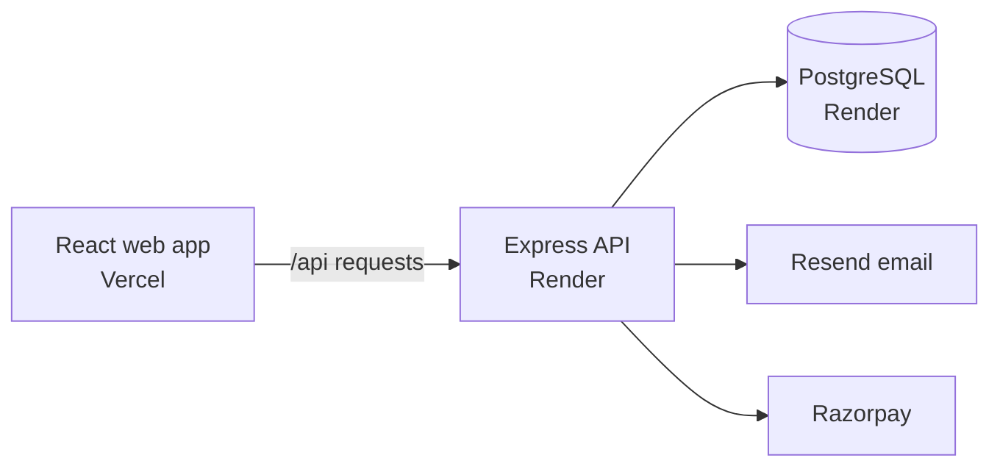

# SocietyOS

### Residential community operations, in one place.

SocietyOS brings resident services, society administration, maintenance billing and gate operations into one web application. It is built with JavaScript, React, Express and PostgreSQL.


> **Current release:** the source is available on [GitHub](https://github.com/shivamvanjara/SocietyOS), on the `main` branch. Hosting has not been provisioned yet; this repository does not represent a live production deployment.

---

## Contents

- [What SocietyOS includes](#what-societyos-includes)
- [How it fits together](#how-it-fits-together)
- [Run it locally](#run-it-locally)
- [Deploy it step by step](#deploy-it-step-by-step)
- [Payments and sensitive settings](#payments-and-sensitive-settings)
- [Useful commands](#useful-commands)
- [Project structure](#project-structure)
- [Security notes](#security-notes)
- [Current limitations](#current-limitations)

## What SocietyOS includes

| Area                | Capabilities                                                                                                                                                                                     |
| ------------------- | ------------------------------------------------------------------------------------------------------------------------------------------------------------------------------------------------ |
| Accounts            | Registration, email verification, sign-in, password recovery, multi-society membership, role-based invitations and administrator MFA                                                             |
| Society setup       | Society profile, buildings, flats, resident records and member roles                                                                                                                             |
| Billing             | Maintenance charges, partial payments, receipts, invoice documents, expense review and society transfer instructions                                                                             |
| Online payments     | Razorpay checkout using the merchant credentials configured by each society                                                                                                                      |
| Resident services   | Notices and read receipts, complaint discussions and status, facility bookings and visitor pass creation                                                                                         |
| Gate operations     | Guard quick entry, resident approval requests, visitor QR scanning, active visitors, entry and exit records, incidents, shift handover, emergency headcount and encrypted offline arrival drafts |
| Platform operations | Super-admin society and account access, subscription plans, subscription checkout and audit history                                                                                              |

Resident, society staff and security-guard access is enforced by the API. Gate registrations await resident authorization unless a resident has created a valid pass. Offline guard drafts are not approvals: entry remains blocked until the draft synchronizes and authorization is recorded.

## How it fits together



The frontend and API use a same-origin `/api/*` proxy. `vercel.json` points that proxy at `https://societyos-api.onrender.com`; if the Render service hostname changes, update the rewrite before deploying the frontend.

## Run it locally

### Prerequisites

- Node.js 22 or newer
- npm 10 or newer
- Docker Desktop with Compose, or PostgreSQL 15 or newer

### Steps

1. **Get the source.**

   ```bash
   git clone https://github.com/shivamvanjara/SocietyOS.git
   cd SocietyOS
   ```

2. **Create your local environment file.**

   macOS/Linux:

   ```bash
   cp .env.example .env
   ```

   Windows PowerShell:

   ```powershell
   Copy-Item .env.example .env
   ```

3. **Set `DATABASE_URL` and `SESSION_SECRET` in `.env`.** For the included local database, the example URL matches the Compose service. Replace the example session secret with a private random value of at least 32 characters. For example:

   ```bash
   node -e "console.log(require('node:crypto').randomBytes(48).toString('base64url'))"
   ```

4. **Start PostgreSQL** if you are using the included Compose service.

   ```bash
   docker compose up -d postgres
   ```

5. **Install dependencies and generate the database client.**

   ```bash
   npm ci
   npm run db:generate
   ```

6. **Apply the checked-in migrations.**

   ```bash
   npm run db:deploy
   ```

7. **Start the app.**

   ```bash
   npm run dev
   ```

8. **Open the web app** at [http://localhost:5173](http://localhost:5173). The API runs at [http://localhost:4000](http://localhost:4000). Use `/api/v1/health` for API liveness and `/api/v1/health/ready` to check API and PostgreSQL readiness.

### Create the first platform administrator

Set `BOOTSTRAP_ADMIN_EMAIL` and a strong, temporary `BOOTSTRAP_ADMIN_PASSWORD` in your local `.env`, then run:

```bash
npm run db:bootstrap-admin
```

Remove the bootstrap password after setup. Keep `.env` private; it is excluded by `.gitignore`.

## Deploy it step by step

### Where the backend goes

Push source code to **GitHub**. Deploy the backend and PostgreSQL database from GitHub using **Render**. Deploy the React frontend from the same repository using **Vercel**. The checked-in `render.yaml` and `vercel.json` provide the starting configuration.

### 1. Deploy the frontend to Vercel

1. Import [`shivamvanjara/SocietyOS`](https://github.com/shivamvanjara/SocietyOS) into Vercel.
2. Keep the project root at the repository root so npm workspaces can resolve `@societyos/shared`.
3. Let Vercel use the checked-in `vercel.json` build settings.
4. Deploy once and note the frontend's Vercel domain. The API can be unavailable until the Render service is ready.

### 2. Deploy the API and database to Render

1. In Render, create a new Blueprint and select the SocietyOS GitHub repository and `main` branch.
2. Review `render.yaml`. It defines the `societyos-api` web service and managed PostgreSQL database in Singapore. **The configured Render plans are paid plans.**
3. Set `WEB_ORIGIN` to the Vercel frontend origin, such as `https://your-project.vercel.app`.
4. Provide the required encryption keys and integration secrets described below using Render's secret settings. Do not commit secrets to GitHub.
5. Deploy. Render runs `npm run db:deploy` before release and checks `/api/v1/health/ready`.
6. Confirm the API readiness endpoint reports healthy before testing the frontend.

### 3. Connect the frontend to the API

1. Confirm the Render web service hostname is `societyos-api.onrender.com`, as expected by `vercel.json`. If Render assigned a different hostname, update the API rewrite in `vercel.json` and push the change.
2. Redeploy the Vercel project after the backend is available.
3. Check sign-up email, password recovery, role-based access, visitor authorization and QR flows, and Razorpay in test mode before inviting a real society.

### 4. Configure payment webhooks

Use these URLs in Razorpay:

```text
https://societyos-api.onrender.com/api/v1/payments/webhooks/razorpay
https://societyos-api.onrender.com/api/v1/subscriptions/webhooks/razorpay
```

Configure the event types listed in [.env.example](.env.example). After changing the API hostname, update both URLs.

## Payments and sensitive settings

- Each society configures its own Razorpay merchant credentials on its Billing page. Resident invoice orders use those credentials and settle to the bank account configured in that society's Razorpay merchant account.
- SocietyOS does not collect resident card or bank credentials. The bank and UPI details in the app are for offline transfers.
- Platform subscription checkout uses the platform Razorpay credentials configured for the API.
- Production requires separate, stable, base64url-encoded 32-byte values for `MFA_ENCRYPTION_KEY` and `RAZORPAY_ACCOUNT_ENCRYPTION_KEY`. Generate and back them up securely; changing a key can make existing encrypted values unreadable.
- Configure a verified Resend sender with `EMAIL_API_KEY` and `EMAIL_FROM` for production verification, recovery and gate-approval email.
- Configure `TRUST_PROXY_HOPS` for the actual reverse-proxy path. Keep it at `0` for local development.

See [deployment guidance](docs/deployment.md) and [security notes](docs/security.md) before handling live resident or financial data.

## Useful commands

| Command               | Purpose                                             |
| --------------------- | --------------------------------------------------- |
| `npm run dev`         | Start the web app and API for local development     |
| `npm run build`       | Build all workspaces                                |
| `npm run lint`        | Lint JavaScript source                              |
| `npm test`            | Run workspace tests                                 |
| `npm run db:validate` | Validate the Prisma schema                          |
| `npm run db:generate` | Generate the Prisma client                          |
| `npm run db:deploy`   | Apply pending migrations to the configured database |
| `npm run db:studio`   | Open Prisma Studio                                  |

Database integration tests require PostgreSQL and `RUN_DATABASE_TESTS=true`; see the CI workflow for the test environment configuration.

## Project structure

```text
apps/
  api/          Express routes, Prisma schema, migrations and API tests
  web/          React/Vite app and role-specific screens
packages/
  shared/       Shared JavaScript package
docs/           Architecture, API, deployment and security notes
```

## Security notes

SocietyOS uses Argon2id password hashing, server-managed sessions, CSRF protection for unsafe browser requests, one-time hashed verification and recovery tokens, role checks, society-scoped data access, and audit records for important operations. Review [docs/security.md](docs/security.md) for configuration details.

## Current limitations

- Hosting is configured in the repository but has not been provisioned; there is no live production URL yet.
- Payment providers, production email, domain, backups and monitoring require account setup and secret configuration.
- The security-guard workflow continues to evolve. See the [visitor API notes](docs/api-specification.md) and current application for supported operations; recurring domestic-worker authorization is not yet implemented.
- Run the full test and security-review suite against the deployment candidate before using real resident or financial data.
